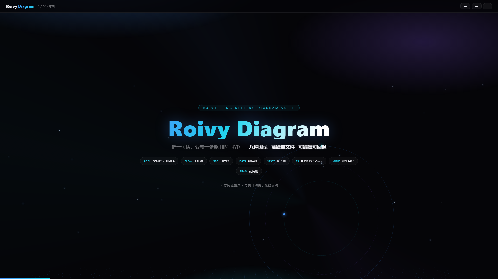
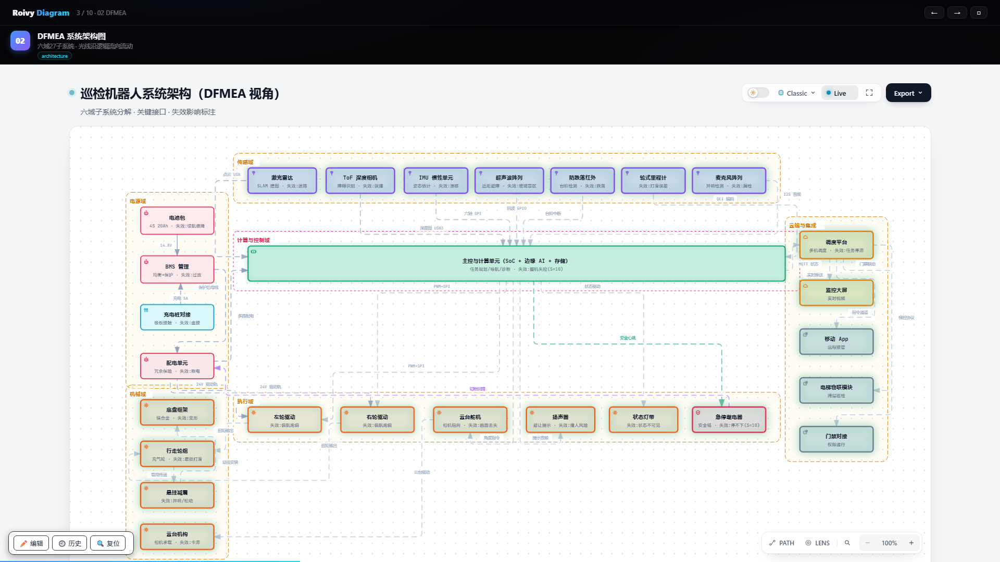
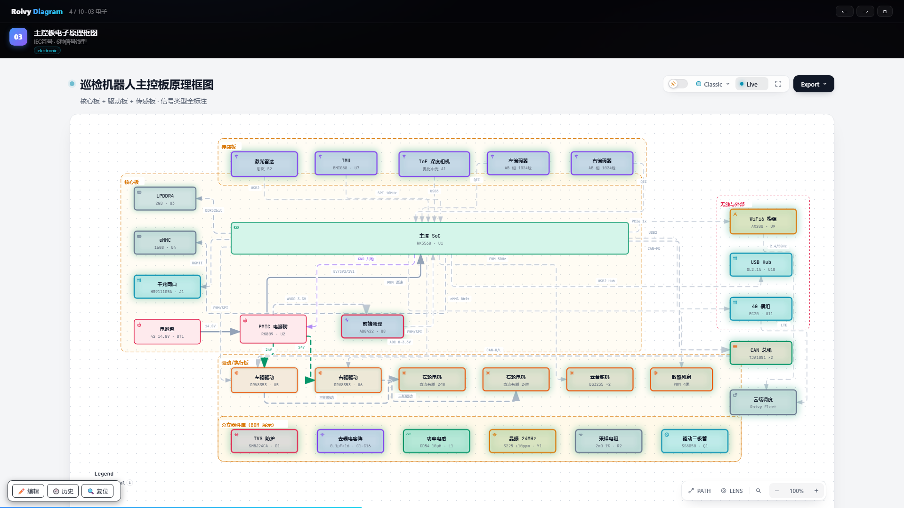
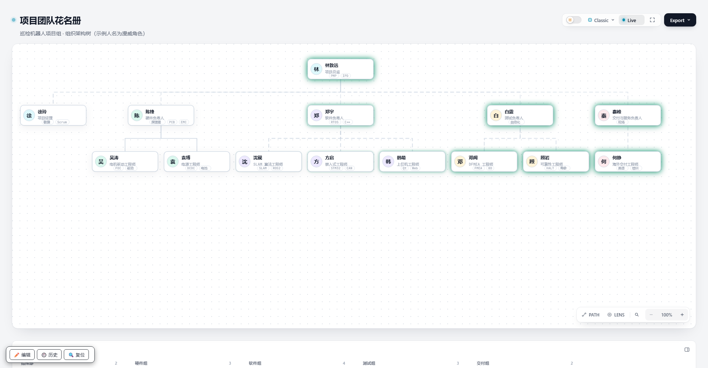
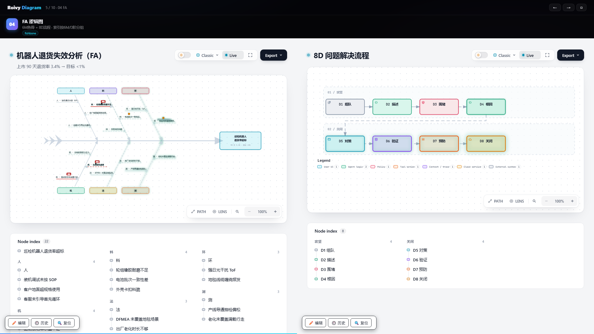
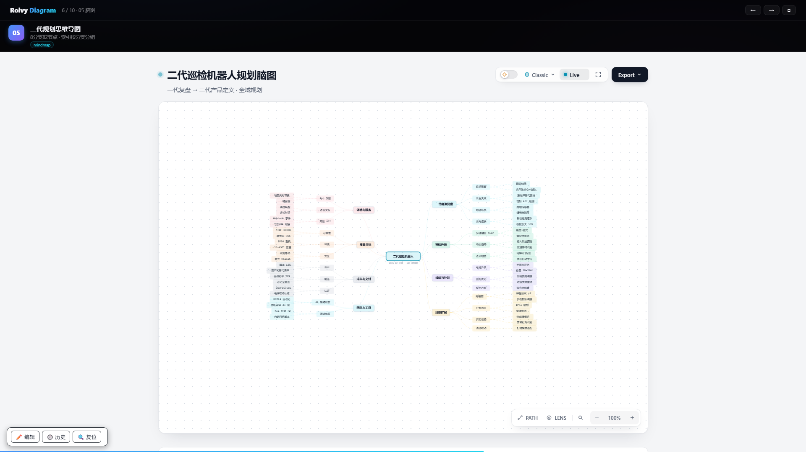
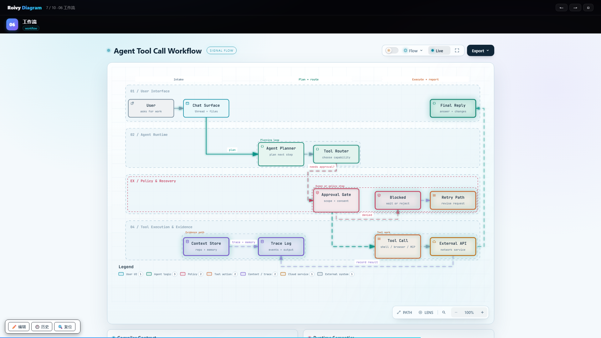
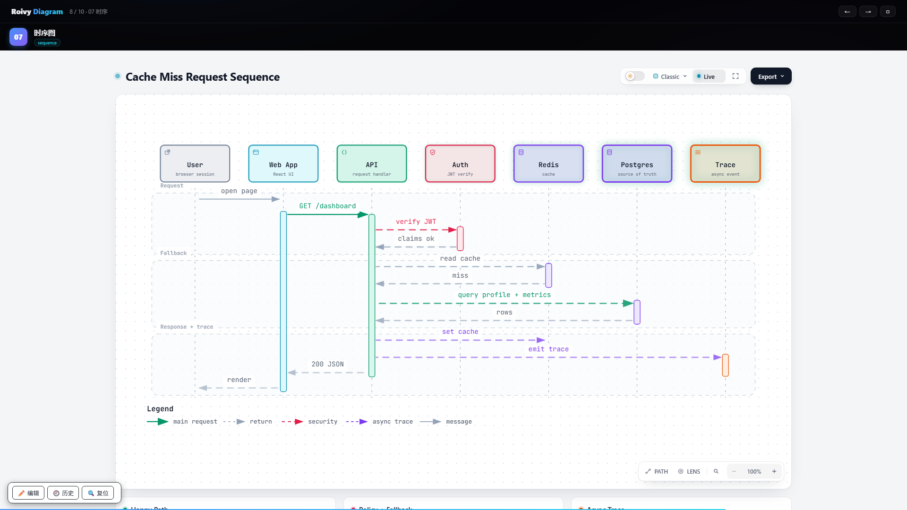
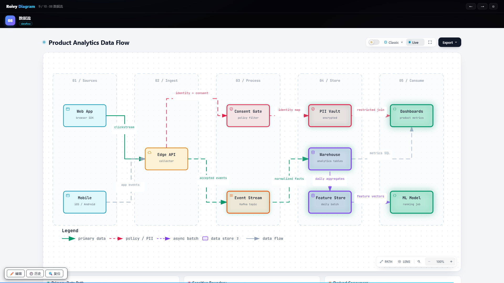
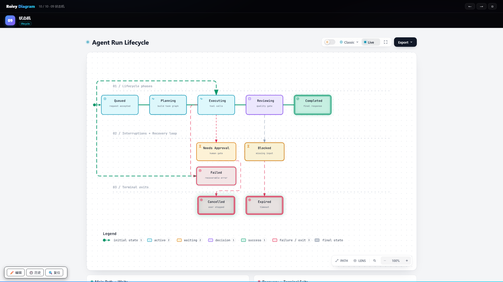

<div align="center">

# Roivy Diagram

**One sentence in. A production-grade engineering diagram out.**

Offline · Single-file HTML · Fully editable · Deterministic

[](LICENSE)
[](rd-diagram/package.json)
[](https://github.com/roivy/rd-flowchart/actions/workflows/ci.yml)
[](https://roivy.github.io/rd-flowchart/demo/)

[Live demo](https://roivy.github.io/rd-flowchart/demo/) · [Quick start](#quick-start) · [The viewer](#the-viewer-is-the-product) · [Editing](#the-file-is-the-database)



</div>

---

Roivy Diagram turns plain descriptions, documents, or Mermaid input into
**validated, standalone HTML engineering diagrams** — no server, no build
step, no network. Every artifact is one self-contained file you can email,
archive, or open on any machine with a browser.

It was built for real R&D work: DFMEA system maps, failure-analysis fishbones,
board-level schematics, team rosters, planning mind maps — with the visual
quality of a product launch, not a whiteboard photo.

## Eight diagram types

| | | |
|---|---|---|
| **Architecture / DFMEA**<br>domains, boundaries, evidence-backed nodes<br>[](docs/screenshots/slide-02-dfmea.png) | **Electronic schematic profile**<br>IEC symbols, six signal line styles<br>[](docs/screenshots/slide-03-mainboard.png) | **Team roster**<br>org tree, skills, grouped index<br>[](docs/screenshots/roster-direct.png) |
| **Fishbone / 8D (FA)**<br>6M bones, risk badges, D1–D8 flow<br>[](docs/screenshots/slide-04-fa-dual.png) | **Mind map**<br>balanced branches, branch-colored bands<br>[](docs/screenshots/slide-05-mindmap.png) | **Workflow**<br>lanes, phases, stops<br>[](docs/screenshots/slide-06-workflow.png) |
| **Sequence**<br>participants, lifelines, returns<br>[](docs/screenshots/slide-07-sequence.png) | **Data flow**<br>stores, pipelines, zones<br>[](docs/screenshots/slide-08-dataflow.png) | **Lifecycle**<br>states, transitions, bands<br>[](docs/screenshots/slide-09-lifecycle.png) |

## The viewer is the product

Every generated file ships with a full interactive runtime — not a static picture:

- **Trace animation** — light flows along every edge in logic direction; nodes
  pulse on load. Replays on every page entry in deck mode.
- **Route probe** — pick any two nodes; the path lights up, hop by hop, with a
  journey playback.
- **Upstream / downstream reachability** — one click traces everything a node
  depends on, or everything that depends on it.
- **Semantic passport** — click a node: metadata, authored details (duties,
  experience, evidence), and relationships in one panel.
- **Grouped node index** — a bottom rail indexes every node by team, branch,
  6M category, or lane; click to fly to it.
- **Themes, presets, exports** — dark/light, multiple visual presets,
  print-safe export, standalone SVG.
- **draw.io export** — one command turns any diagram into an editable
  `.drawio` file (deterministic mxGraph XML, waypoints and group frames
  preserved).
- **Presentation deck & encrypted sharing** — build a keynote-style deck from
  your artifacts, page-enter light effects included, and emit a single
  encrypted `index_share.html` for controlled distribution.

## The file is the database

Diagrams are meant to live, not rot:

- **Edit in place** — drag nodes (edges re-route), edit labels, zoom with
  Ctrl+wheel.
- **Save writes back to the same file** — via the File System Access API; no
  downloads, no version sprawl.
- **History with rollback** — every save snapshots the prior state inside the
  file (up to 15 steps); restore any snapshot with one click.
- **AI re-editing contract** — each artifact embeds its own source of truth,
  so an AI agent can re-open, understand, and regenerate it later.

## Quick start

```bash
git clone https://github.com/roivy/rd-flowchart.git
cd rd-diagram/rd-diagram
npm install
npm test          # 1900+ checks, including real-browser gates
```

Render your first diagram:

```bash
node bin/rd.mjs render architecture examples/web-app.architecture.json out.html
```

All eight types:

```bash
node bin/rd.mjs render architecture  input.json out.html   # also DFMEA & schematics
node bin/rd.mjs render workflow      input.json out.html
node bin/rd.mjs render sequence      input.json out.html
node bin/rd.mjs render dataflow      input.json out.html
node bin/rd.mjs render lifecycle     input.json out.html
node bin/rd.mjs render fishbone      input.json out.html
node bin/rd.mjs render mindmap       input.json out.html
node bin/rd.mjs render roster        input.json out.html
```

Schemas and worked examples for every type live in
[`rd-diagram/examples/`](rd-diagram/examples) and
[`rd-diagram/schemas/`](rd-diagram/schemas).

**As an AI-agent skill** — the package doubles as a skill: agents read
[`rd-diagram/SKILL.md`](rd-diagram/SKILL.md) to author diagrams from plain
language, follow the delivery contract, and honor the re-editing contract
above. Point your agent runtime at the `rd-diagram/` directory.

**Requirements** — Node ≥ 18; any modern browser for artifacts. Everything
runs offline.

## Live demo

A ten-page, zero-click demo deck (cover + one page per diagram type):

➡️ **[roivy.github.io/rd-flowchart/demo](https://roivy.github.io/rd-flowchart/demo/)**

Arrow keys to flip pages; every page auto-plays its trace animation and shows
its grouped node index.

## Project layout

```
rd-diagram/     the engine: renderers, schemas, viewer runtime, CLI, tests
viewer/         viewer runtime sources (CSS/JS modules)
demo/           the live demo deck
tools/          deck builders + encrypted share bundler
examples/       worked example artifacts
docs/           screenshots
```

## Contributing

Issues and pull requests are welcome — see [CONTRIBUTING.md](CONTRIBUTING.md).
Every change runs the full deterministic gate: schema validation, golden
renders, and real-browser checks.

## Security

See [SECURITY.md](SECURITY.md). Artifacts run fully offline; the engine never
makes network calls.

## License

[MIT](LICENSE) — free for commercial and internal use.
